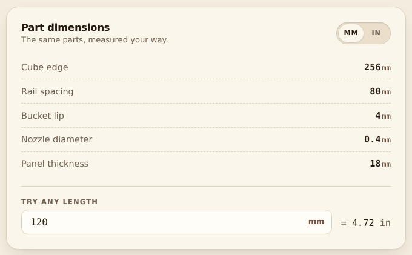
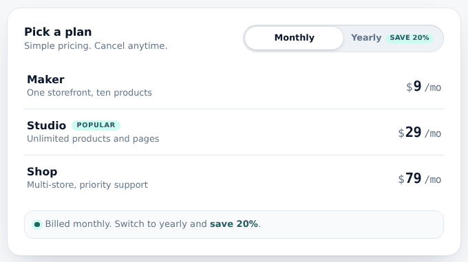
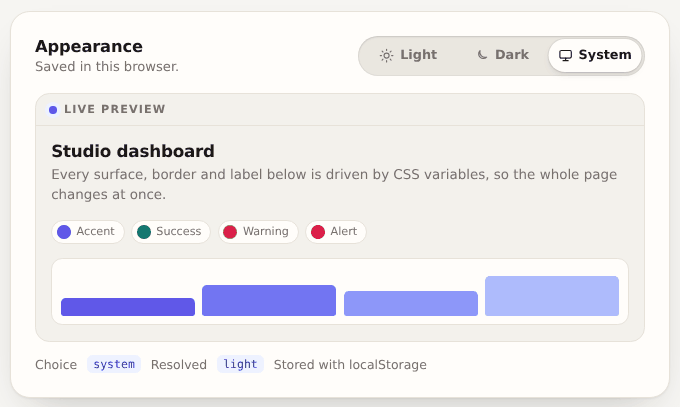

# Switches

Four zero-dependency UI switches in plain HTML, CSS and JavaScript. No framework,
no build step, no CDN. Copy one into any page and it works.

**Showcase:** [index.html](index.html) &middot; [GitHub Pages](https://theminescout.github.io/switches/)

| # | Switch | What it does |
| - | ------ | ------------ |
| 01 | [mm &vert; in unit switch](mm-in-unit-switch/example.html) | The unit toggle from The Chop Lab, with live millimetre to inch conversion. |
| 02 | [Billing cycle switch](billing-cycle-switch/example.html) | Monthly / Yearly with a Save 20% badge that updates plan prices in place. |
| 03 | [Theme appearance switch](theme-appearance-switch/example.html) | Light / Dark / System segmented pill with `localStorage` persistence. |
| 04 | [Temperature unit switch](temperature-unit-switch/example.html) | °F / °C toggle wired to a live temperature converter. |

## 01. mm | in unit switch



Ported from [The Chop Lab](https://chop-lab.com). Sample part dimensions are
stored in millimetres and converted the moment you flip the switch, the same way
Chop Lab's `useLength` hook does it. Includes a free-form length field and
remembers the choice.

- [Live example](mm-in-unit-switch/example.html) &middot; [GitHub Pages](https://theminescout.github.io/switches/mm-in-unit-switch/example.html)
- [How to add it](mm-in-unit-switch/how-to-add.md)

## 02. Billing cycle switch



A Monthly / Yearly pricing toggle. Every plan price updates in place, yearly mode
shows the discounted monthly rate plus the real annual total, and the summary
line explains the saving.

- [Live example](billing-cycle-switch/example.html) &middot; [GitHub Pages](https://theminescout.github.io/switches/billing-cycle-switch/example.html)
- [How to add it](billing-cycle-switch/how-to-add.md)

## 03. Theme appearance switch



A tactile three-way pill with a springy thumb. Light and Dark are explicit
choices, System follows `prefers-color-scheme` and updates when the operating
system changes. The choice is saved in `localStorage`, and the demo page flips
as a whole.

- [Live example](theme-appearance-switch/example.html) &middot; [GitHub Pages](https://theminescout.github.io/switches/theme-appearance-switch/example.html)
- [How to add it](theme-appearance-switch/how-to-add.md)

## 04. Temperature unit switch


A °F / °C switch wired to a live range slider and sample temperatures. One
canonical Celsius value feeds the big readout, the scale labels, the slider fill
and the sample chips, so they can never drift apart.

- [Live example](temperature-unit-switch/example.html) &middot; [GitHub Pages](https://theminescout.github.io/switches/temperature-unit-switch/example.html)
- [How to add it](temperature-unit-switch/how-to-add.md)

## Use a switch

1. Open a switch folder and view `example.html`. It is self-contained: one HTML
   file with its CSS and JavaScript inline.
2. Copy the markup, the styles and the script you need into your page.
3. Read `how-to-add.md` in the same folder for the full snippet and the
   customization table.

Each folder contains exactly two files:

```
mm-in-unit-switch/
  example.html   self-contained live demo
  how-to-add.md  copy-paste guide and customization options
```

## Run the examples locally

The pages work from the filesystem, but `localStorage` is more reliable over
HTTP. From the repository root:

```bash
python3 -m http.server 8000
# then open http://localhost:8000/index.html
```

## Verify and regenerate the previews

The previews are captured with headless Chromium through Playwright, cropped to
the demo card, and written to `previews/`.

```bash
python3 -m pip install -r requirements-dev.txt
python3 scripts/capture_previews.py            # all four GIFs
python3 scripts/capture_previews.py --only mm-in-unit-switch
```

The test suite loads every page at desktop (1280x800) and mobile (390x844) sizes
and checks for console errors, horizontal overflow, working conversions,
persistence, and valid animated previews:

```bash
python3 -m unittest discover -s tests -v
```

## Accessibility

- Switches are `role="group"` containers of real buttons with `aria-pressed`.
- Arrow keys, Home and End move between options; focus stays visible.
- Every state change is announced through a polite live region.
- Colour is never the only signal; the active option also changes weight and
  surface.
- All animations are disabled under `prefers-reduced-motion: reduce`.
- Pages are responsive down to 320px wide with no horizontal scrolling.

## Browser support

Evergreen Chrome, Edge, Firefox and Safari. The code uses CSS custom properties,
`grid`, `matchMedia`, `URLSearchParams` and `localStorage`, all of which are
widely available. There are no polyfills and no dependencies.

## Credits

The mm &vert; in switch is adapted from [The Chop Lab](https://chop-lab.com)
(`src/lib/units.ts`, `src/components/length.tsx` and the header unit toggle).

Built by [Minescout Studio](https://minescout.net/studio).

## License

[MIT](LICENSE)
