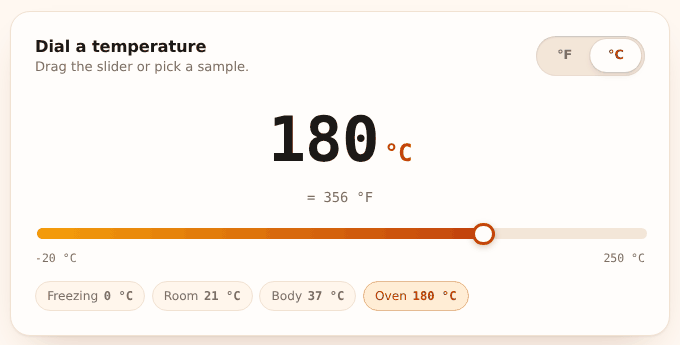
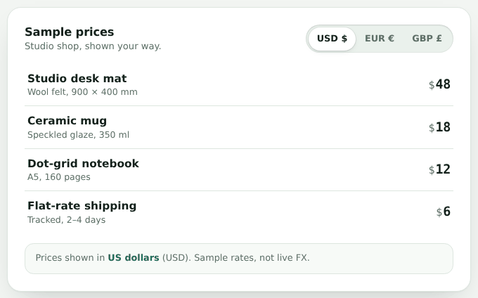
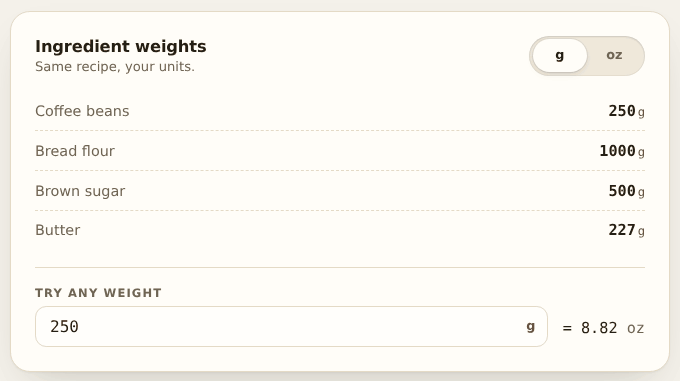
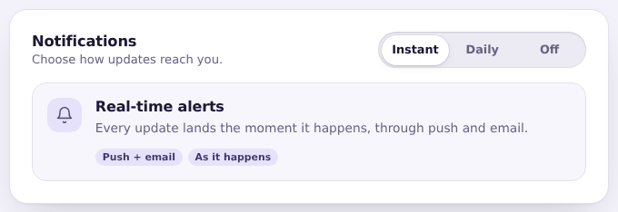
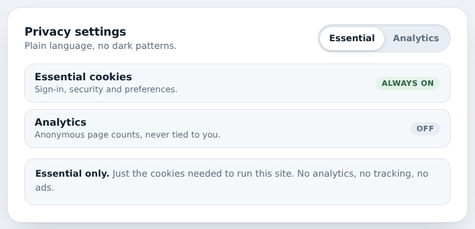
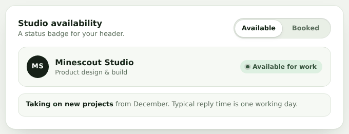
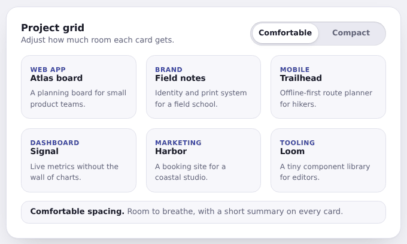

# Switches

Ten zero-dependency UI switches in plain HTML, CSS and JavaScript. No framework,
no build step, no CDN. Copy one into any page and it works.

**Showcase:** [index.html](index.html) &middot; [GitHub Pages](https://theminescout.github.io/switches/)

## Find your perfect switch

Answer the branching questions below. Each answer opens the next one, and every
leaf links straight to the animated preview, the copy-paste guide and the live
demo. The whole decision tree is generated from [`switches.json`](switches.json)
by [`scripts/sync_readme.py`](scripts/sync_readme.py), so it never drifts from
the library.

<!-- AUTO-GENERATED:SWITCH-FINDER START -->
<!-- AUTO-GENERATED -->
> **Don't see the switch you need? [Request a new switch](https://github.com/TheMinescout/switches/issues/new?title=New+Switch+Request%3A+&body=**What+should+the+switch+toggle%3F**%0A%0A**Options+(e.g.+Option+A+%7C+Option+B)%3A**%0A%0A**Where+do+you+plan+to+use+it%3F**).**

Prefer a flat list? Jump to the [switch library](#switch-library).

**Step 1 — What do you need to switch?** Open the category that matches.

<details>
<summary><strong>Measurement & units</strong></summary>

**Step 2 — How many options?** Choose the shape that matches.

<details>
<summary>2 options</summary>

**Step 3 — Which one fits?** Pick the closest match.

<details>
<summary>Length (mm / in)</summary>

**mm | in unit switch** — The unit toggle from The Chop Lab, with live millimetre to inch conversion.

- [Jump to the animated preview](#01-mm--in-unit-switch)
- [How to add it](mm-in-unit-switch/how-to-add.md)
- [Live demo](https://theminescout.github.io/switches/mm-in-unit-switch/example.html)

</details>

<details>
<summary>Temperature (°F / °C)</summary>

**Temperature unit switch** — °F / °C toggle wired to a live temperature converter.

- [Jump to the animated preview](#04-temperature-unit-switch)
- [How to add it](temperature-unit-switch/how-to-add.md)
- [Live demo](https://theminescout.github.io/switches/temperature-unit-switch/example.html)

</details>

<details>
<summary>Weight (g / oz)</summary>

**Weight unit switch** — g / oz mass toggle with live conversion and localStorage persistence.

- [Jump to the animated preview](#06-weight-unit-switch)
- [How to add it](weight-unit-switch/how-to-add.md)
- [Live demo](https://theminescout.github.io/switches/weight-unit-switch/example.html)

</details>

</details>

</details>

<details>
<summary><strong>Pricing & money</strong></summary>

**Step 2 — How many options?** Choose the shape that matches.

<details>
<summary>2 options</summary>

**Billing cycle switch** — Monthly / Yearly with a Save 20% badge that updates plan prices in place.

- [Jump to the animated preview](#02-billing-cycle-switch)
- [How to add it](billing-cycle-switch/how-to-add.md)
- [Live demo](https://theminescout.github.io/switches/billing-cycle-switch/example.html)

</details>

<details>
<summary>3 options</summary>

**Currency unit switch** — USD / EUR / GBP pill that converts sample prices live.

- [Jump to the animated preview](#05-currency-unit-switch)
- [How to add it](currency-unit-switch/how-to-add.md)
- [Live demo](https://theminescout.github.io/switches/currency-unit-switch/example.html)

</details>

</details>

<details>
<summary><strong>Appearance & layout</strong></summary>

**Step 2 — How many options?** Choose the shape that matches.

<details>
<summary>2 options</summary>

**View density switch** — Comfortable / Compact toggle that re-spaces a sample card grid.

- [Jump to the animated preview](#10-view-density-switch)
- [How to add it](view-density-switch/how-to-add.md)
- [Live demo](https://theminescout.github.io/switches/view-density-switch/example.html)

</details>

<details>
<summary>3 options</summary>

**Theme appearance switch** — Light / Dark / System segmented pill with localStorage persistence.

- [Jump to the animated preview](#03-theme-appearance-switch)
- [How to add it](theme-appearance-switch/how-to-add.md)
- [Live demo](https://theminescout.github.io/switches/theme-appearance-switch/example.html)

</details>

</details>

<details>
<summary><strong>Notifications</strong></summary>

**Step 2 — How many options?** Choose the shape that matches.

<details>
<summary>3 options</summary>

**Notification cadence switch** — Instant / Daily / Off segmented pill that previews alert behaviour.

- [Jump to the animated preview](#07-notification-cadence-switch)
- [How to add it](notification-cadence-switch/how-to-add.md)
- [Live demo](https://theminescout.github.io/switches/notification-cadence-switch/example.html)

</details>

</details>

<details>
<summary><strong>Privacy & consent</strong></summary>

**Step 2 — How many options?** Choose the shape that matches.

<details>
<summary>2 options</summary>

**Privacy consent switch** — Essential / Analytics consent toggle with a live plain-language summary.

- [Jump to the animated preview](#08-privacy-consent-switch)
- [How to add it](privacy-consent-switch/how-to-add.md)
- [Live demo](https://theminescout.github.io/switches/privacy-consent-switch/example.html)

</details>

</details>

<details>
<summary><strong>Availability & status</strong></summary>

**Step 2 — How many options?** Choose the shape that matches.

<details>
<summary>2 options</summary>

**Availability status switch** — Available / Booked studio status badge for freelancer headers.

- [Jump to the animated preview](#09-availability-status-switch)
- [How to add it](availability-status-switch/how-to-add.md)
- [Live demo](https://theminescout.github.io/switches/availability-status-switch/example.html)

</details>

</details>

> **Still not sure? [Request a new switch](https://github.com/TheMinescout/switches/issues/new?title=New+Switch+Request%3A+&body=**What+should+the+switch+toggle%3F**%0A%0A**Options+(e.g.+Option+A+%7C+Option+B)%3A**%0A%0A**Where+do+you+plan+to+use+it%3F**) and describe what it should toggle.**
<!-- AUTO-GENERATED:SWITCH-FINDER END -->

## Switch library

The table below is also generated from [`switches.json`](switches.json). Run
`python3 scripts/sync_readme.py` after changing the manifest.

<!-- AUTO-GENERATED:SWITCH-TABLE START -->
<!-- AUTO-GENERATED -->
| # | Switch | Category | What it does |
| - | ------ | -------- | ------------ |
| 01 | [mm &vert; in unit switch](mm-in-unit-switch/example.html) | Measurement & units | The unit toggle from The Chop Lab, with live millimetre to inch conversion. |
| 02 | [Billing cycle switch](billing-cycle-switch/example.html) | Pricing & money | Monthly / Yearly with a Save 20% badge that updates plan prices in place. |
| 03 | [Theme appearance switch](theme-appearance-switch/example.html) | Appearance & layout | Light / Dark / System segmented pill with localStorage persistence. |
| 04 | [Temperature unit switch](temperature-unit-switch/example.html) | Measurement & units | °F / °C toggle wired to a live temperature converter. |
| 05 | [Currency unit switch](currency-unit-switch/example.html) | Pricing & money | USD / EUR / GBP pill that converts sample prices live. |
| 06 | [Weight unit switch](weight-unit-switch/example.html) | Measurement & units | g / oz mass toggle with live conversion and localStorage persistence. |
| 07 | [Notification cadence switch](notification-cadence-switch/example.html) | Notifications | Instant / Daily / Off segmented pill that previews alert behaviour. |
| 08 | [Privacy consent switch](privacy-consent-switch/example.html) | Privacy & consent | Essential / Analytics consent toggle with a live plain-language summary. |
| 09 | [Availability status switch](availability-status-switch/example.html) | Availability & status | Available / Booked studio status badge for freelancer headers. |
| 10 | [View density switch](view-density-switch/example.html) | Appearance & layout | Comfortable / Compact toggle that re-spaces a sample card grid. |
<!-- AUTO-GENERATED:SWITCH-TABLE END -->

## 01. mm | in unit switch


Ported from [The Chop Lab](https://chop-lab.com). Sample part dimensions are
stored in millimetres and converted the moment you flip the switch, the same way
Chop Lab's `useLength` hook does it. Includes a free-form length field and
remembers the choice.

- [Live example](mm-in-unit-switch/example.html) &middot; [GitHub Pages](https://theminescout.github.io/switches/mm-in-unit-switch/example.html)
- [How to add it](mm-in-unit-switch/how-to-add.md)

## 02. Billing cycle switch


A Monthly / Yearly pricing toggle. Every plan price updates in place, yearly mode
shows the discounted monthly rate plus the real annual total, and the summary
line explains the saving.

- [Live example](billing-cycle-switch/example.html) &middot; [GitHub Pages](https://theminescout.github.io/switches/billing-cycle-switch/example.html)
- [How to add it](billing-cycle-switch/how-to-add.md)

## 03. Theme appearance switch


A tactile three-way pill with a springy thumb. Light and Dark are explicit
choices, System follows `prefers-color-scheme` and updates when the operating
system changes. The choice is saved in `localStorage`, and the demo page flips
as a whole.

- [Live example](theme-appearance-switch/example.html) &middot; [GitHub Pages](https://theminescout.github.io/switches/theme-appearance-switch/example.html)
- [How to add it](theme-appearance-switch/how-to-add.md)

## 04. Temperature unit switch



A °F / °C switch wired to a live range slider and sample temperatures. One
canonical Celsius value feeds the big readout, the scale labels, the slider fill
and the sample chips, so they can never drift apart.

- [Live example](temperature-unit-switch/example.html) &middot; [GitHub Pages](https://theminescout.github.io/switches/temperature-unit-switch/example.html)
- [How to add it](temperature-unit-switch/how-to-add.md)

## 05. Currency unit switch



A three-way `USD | EUR | GBP` pill. Every price is stored in US dollars and
converted live, with the currency symbol following the active choice. Sample
rates are used for the demo.

- [Live example](currency-unit-switch/example.html) &middot; [GitHub Pages](https://theminescout.github.io/switches/currency-unit-switch/example.html)
- [How to add it](currency-unit-switch/how-to-add.md)

## 06. Weight unit switch



A `g | oz` mass toggle for recipes and shipping labels. Weights are stored in
grams, converted the moment you flip the switch, and the choice is remembered in
`localStorage`. Includes a free-form weight field.

- [Live example](weight-unit-switch/example.html) &middot; [GitHub Pages](https://theminescout.github.io/switches/weight-unit-switch/example.html)
- [How to add it](weight-unit-switch/how-to-add.md)

## 07. Notification cadence switch



An `Instant | Daily | Off` segmented pill that previews the active alert
behaviour. The panel below the switch changes its title, description and chips,
so the setting is never abstract.

- [Live example](notification-cadence-switch/example.html) &middot; [GitHub Pages](https://theminescout.github.io/switches/notification-cadence-switch/example.html)
- [How to add it](notification-cadence-switch/how-to-add.md)

## 08. Privacy consent switch



An `Essential | Analytics` consent toggle with a plain-language summary. The
analytics row, its state badge and the explanation all update together, and the
choice persists.

- [Live example](privacy-consent-switch/example.html) &middot; [GitHub Pages](https://theminescout.github.io/switches/privacy-consent-switch/example.html)
- [How to add it](privacy-consent-switch/how-to-add.md)

## 09. Availability status switch



An `Available | Booked` studio status toggle for freelancer headers. The badge,
its dot colour and the note beneath it change together, making it obvious at a
glance whether you are taking work.

- [Live example](availability-status-switch/example.html) &middot; [GitHub Pages](https://theminescout.github.io/switches/availability-status-switch/example.html)
- [How to add it](availability-status-switch/how-to-add.md)

## 10. View density switch



A `Comfortable | Compact` control for dense dashboards. It changes the grid gap,
card padding and how much detail each card shows, without swapping any content.

- [Live example](view-density-switch/example.html) &middot; [GitHub Pages](https://theminescout.github.io/switches/view-density-switch/example.html)
- [How to add it](view-density-switch/how-to-add.md)

## Use a switch

1. Open a switch folder and view `example.html`. It is self-contained: one HTML
   file with its CSS and JavaScript inline.
2. Copy the markup, the styles and the script you need into your page.
3. Read `how-to-add.md` in the same folder for the full snippet and the
   customization table.

Each folder contains exactly two files:

```
mm-in-unit-switch/
  example.html   self-contained live demo
  how-to-add.md  copy-paste guide and customization options
```

## Run the examples locally

The pages work from the filesystem, but `localStorage` is more reliable over
HTTP. From the repository root:

```bash
python3 -m http.server 8000
# then open http://localhost:8000/index.html
```

## Verify and regenerate the previews

The previews are captured with headless Chromium through Playwright, cropped to
the demo card, and written to `previews/`.

```bash
python3 -m pip install -r requirements-dev.txt
python3 scripts/capture_previews.py            # all ten GIFs
python3 scripts/capture_previews.py --only mm-in-unit-switch
```

The test suite loads every page at desktop (1280x800), mobile (390x844) and
small (320x640) sizes and checks for console errors, horizontal overflow,
working conversions, persistence, valid animated previews and a README that is
in sync with `switches.json`:

```bash
python3 -m unittest discover -s tests -v
```

## Add a new switch

`switches.json` is the single source of truth for the library. To add a switch:

1. Create `<slug>/example.html` and `<slug>/how-to-add.md` following the existing
   folders.
2. Add an entry to `switches.json` with its number, slug, name, summary,
   category, option count, tags and quiz detail.
3. Run `python3 scripts/sync_readme.py` to regenerate the table and Switch
   Finder quiz in this file.
4. Add the preview config to `scripts/capture_previews.py` and run it.
5. Extend `tests/test_examples.py` with a functional check for the new switch.

`python3 scripts/sync_readme.py --check` exits non-zero when this file is stale,
which is what the test suite uses.

## Accessibility

- Switches are `role="group"` containers of real buttons with `aria-pressed`.
- Arrow keys, Home and End move between options; focus stays visible.
- Every state change is announced through a polite live region.
- Colour is never the only signal; the active option also changes weight and
  surface.
- All animations are disabled under `prefers-reduced-motion: reduce`.
- Pages are responsive down to 320px wide with no horizontal scrolling.

## Browser support

Evergreen Chrome, Edge, Firefox and Safari. The code uses CSS custom properties,
`grid`, `matchMedia`, `URLSearchParams` and `localStorage`, all of which are
widely available. There are no polyfills and no dependencies.

## Credits

The mm &vert; in switch is adapted from [The Chop Lab](https://chop-lab.com)
(`src/lib/units.ts`, `src/components/length.tsx` and the header unit toggle).

Built by [Minescout Studio](https://minescout.net/studio).

## License

[MIT](LICENSE)
